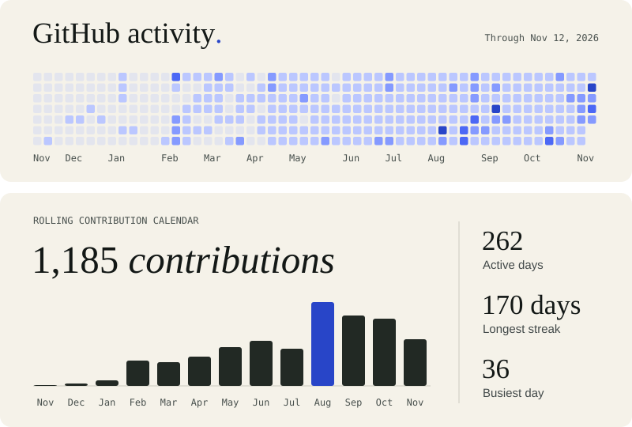
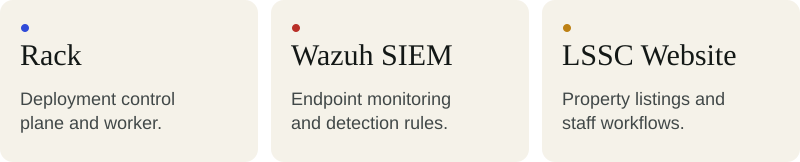

## Selected work

- **Rack / Hercules Deploy** — Deployment platform with a control plane and a worker for running deployments.
- **[Wazuh SIEM Homelab](https://github.com/Jairoy2426/wazuh-siem-homelab)** — Wazuh on Proxmox, monitoring a Windows endpoint with Sysmon and custom detection rules mapped to MITRE ATT&CK.
- **LSSC Website** — Full-stack property management platform with public listings, auctions, staff workflows, and an admin console.
- **[CI/CD Pipeline](https://github.com/Jairoy2426/ci-cd-pipeline)** — Automated application deployment using GitHub Actions, Docker, and Nginx.
- **[NULLHOUND](https://github.com/Jairoy2426/NULLHOUND)** — Python CLI that audits Linux configurations against CIS benchmarks and reports findings.
- **HerculesDev Core** — Client portal with Discord sign-in, invoices, payments, and receipts.

## Tools I work with

- **Infrastructure** · Linux, Docker, Nginx, Cloudflare, Proxmox, GitHub Actions
- **Security** · Wazuh, Sysmon, MITRE ATT&CK, CIS Benchmarks
- **Software** · TypeScript, Node.js, Next.js, Python, MongoDB, PostgreSQL

[GitHub](https://github.com/Jairoy2426) · [Public repositories](https://github.com/Jairoy2426?tab=repositories)
